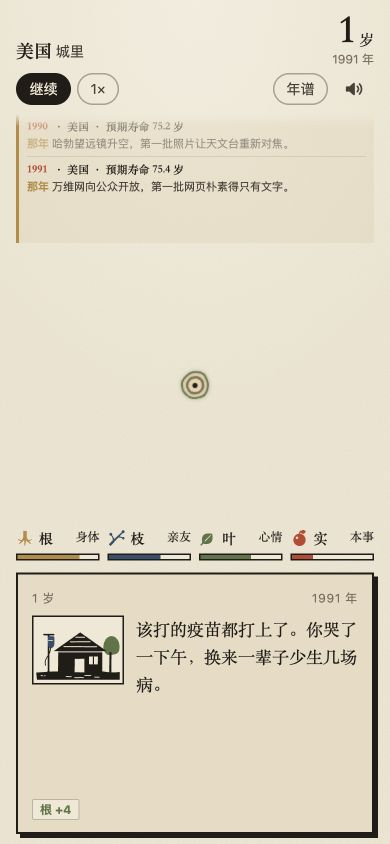

# 年轮 · Nianlun (Tree Rings)

**[Play in your browser · 在线试玩](https://bytewatcher.xyz/games/nianlun/)**

An offline HTML5 life-simulation game that turns each year of a fictional life into a new tree ring. Birthplace, birth year, historical context and player choices shape the story.

The game interface is in Chinese and is designed for portrait screens. Desktop browsers display the same game in a centered column.



## Run the game

The ready-to-play build is [dist/nianlun.html](dist/nianlun.html). Download this repository, then serve that directory locally:

```sh
python3 -m http.server 8000 --bind 127.0.0.1 --directory dist
```

Open `http://127.0.0.1:8000/nianlun.html`. The build includes its scripts, styles, artwork and runtime data, so the game does not need a remote application server. Saved lives stay in browser local storage.

## How to play

1. Choose a birth year and hold the wind button to begin a life.
2. Explore a birthplace and its statistical background.
3. Read the yearly timeline, make choices and distribute growth across body, relationships, mood and skills.
4. Watch the rings grow, revisit individual years and compare the life with four companions.
5. Generate a life-ring poster or start again.

Country-level statistics inform the background. Life events and individual outcomes are game simulations, not predictions for real people. Historical coverage and country-specific detail vary.

## Develop and build

Requires Node.js. No npm packages are needed for the build.

```sh
npm run build
npm test
```

`npm run build` recreates the single-file game from `src/` and `assets/`. `npm test` runs the existing country/culture/era simulation checks. Additional simulation checks are available through `npm run test:sim`, `npm run test:country` and `npm run test:country2`.

## Cursor contribution for Builders Week

For this iteration, Cursor refined the playback controls in an existing game. It fixed the pause button's accessible name remaining “pause” after the visible action changed to “resume”, and synchronized the speed button's accessible name with 1×, 2×, 4× and the 40× demo mode. Initialization uses the same update functions.

The actual change is preserved in [docs/cursor-contribution.patch](docs/cursor-contribution.patch). Nine targeted accessibility-name checks passed. The updated build was also inspected in browser simulations at 360×800, 390×844 and 430×932; this is not a claim of physical-device or VoiceOver/TalkBack testing.

## Project files

- `src/`: browser game and the generated runtime data snapshots.
- `assets/`: SVG artwork used by the game.
- `tools/`: single-file builder and portable simulation checks.
- `dist/nianlun.html`: the current standalone build.
- `data/`: public source-query metadata and configuration provenance.
- `docs/`: gameplay screenshot and the Cursor contribution patch.

## Sources and attribution

See [DATA_SOURCES.md](DATA_SOURCES.md) for World Bank WDI, Natural Earth and country/era configuration attribution. Runtime data is included locally; the source-query metadata records the underlying inputs and transformations. A license for the original code and artwork has not been selected; third-party data retains its own terms.

## 中文说明

《年轮》把虚构人生的每一年画成一圈年轮。选择出生年代，随机落地，在事件与选择中体验不同人生；终章可以逐年回看、听年轮、比较同伴并生成年轮卡。源码和当前单文件成品均在本仓库，数据来源与简化边界见上方说明。
