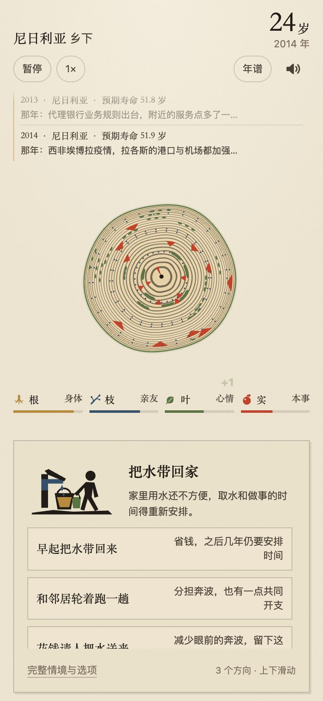

# 年轮 · Nianlun (Tree Rings)

**[Play in your browser · 在线试玩](https://bytewatcher.xyz/games/nianlun/)**

An offline HTML5 life-simulation game that turns each year of a fictional life into a new tree ring. Experience how birthplace, birth year, family circumstances and choices shape daily life.

The interface is in Chinese and designed for portrait screens. Desktop browsers display the same game in a centered column. The hosted demo is maintained separately; use the checked-in build to try this repository revision.



## Run the game

Serve the ready-to-play [dist/nianlun.html](dist/nianlun.html) locally:

```sh
python3 -m http.server 8000 --bind 127.0.0.1 --directory dist
```

Open `http://127.0.0.1:8000/nianlun.html`. Scripts, styles, artwork and runtime data are included in the build. The game sends no external network requests; saved lives stay in browser local storage.

## How to play

1. Choose a birth year and hold the wind button to begin a life.
2. Discover a birthplace, family and the conditions of that period.
3. Make choices about learning, work, relationships and everyday responsibilities. Distribute growth across body, relationships, mood and skills.
4. Watch the rings grow, revisit individual years and compare the life with four companions.
5. Generate a life-ring poster or begin again.

Different periods use different birth weights and available education, employment, health and income statistics. Electricity and water conditions can create shared daily-life choices with effects on later learning, time or spending. Where covered, real residential price changes affect the housing model and asset settlement. Country statistics constrain game models; they are not individual probabilities or forecasts.

For reproducible 1990 playthroughs, append `?seed=22222228&y=1990` for India, `?seed=2222225A&y=1990` for Brazil, or `?seed=2222224F&y=1990` for Nigeria. These are fixed examples, not a representative statistical sample. The same seed with a different birth year can select a different country because birth weights change over time.

## Current implementation

- The imported synchronous event core preserves 278 event entries, 188 registered decision classes and 91 named annual handlers. It is used for 170 matching locations; 22 locations retain the original Nianlun model.
- A 192-location, 1960–2025 framework holds 19 historical fields. Coverage varies by field and year. The runtime distinguishes source-published values, interpolation, limited carry-forward, estimates and missing data. A source-published ILO or similar value can itself be a statistical estimate.
- Population compression retains precision to one person. A country's earliest available observation is never copied backwards into earlier missing years.
- Available education, employment structure and medical spending data feed existing decision and cost paths. National gross enrollment is not a person's admission probability; health expenditure composition is not a personal reimbursement rate.
- BIS Q4 real residential indices cover 57 matching locations and 2,122 year-end index records. Housing changes apply conservatively to the urban model. This is not a global rent dataset or an observation of every household's housing burden.
- Illustrated cards show a short situation and actions. Full text and choices remain available in the detail sheet. Historical context accumulates in a scrollable yearly timeline.

Historical coverage, institutions and country-specific detail vary. Some school, military-service and other institutional rules remain simplified source-game configurations. Future years are simulation scenarios. See [DATA_SOURCES.md](DATA_SOURCES.md) for provenance and limitations.

## Develop and validate

Use a modern Node.js release (the current checks used Node.js 26.3.1). The regular build and simulation tests use built-in Node modules and the checked-in snapshots:

```sh
npm run build
npm test
```

The build recreates the single-file game from `src/` and `assets/`. `npm test` runs 12 data/effect checks, seven imported-core checks including 1,152 lives, and ten isolated legacy-model checks. Passing legacy calibration does not establish calibration of the imported core. Historical browser simulations cover 360×800, 390×844 and 430×932, with 16 controlled scenes per viewport; they are not physical-device acceptance. Results and bundle hashes are recorded in [docs/validation.json](docs/validation.json).

Additional commands include `test:living`, `test:source`, `test:legacy`, `test:world`, `test:country` and `test:country2`. The last three explicitly exercise the preserved legacy model.

The optional browser harness uses Chrome and a loopback HTTP preview. `CHROME_EXECUTABLE` can point to a Chrome binary and `NIANLUN_PREVIEW_URL` to the served build:

```sh
NIANLUN_PREVIEW_URL=http://127.0.0.1:8000/nianlun.html npm run test:browser
```

Raw population responses needed by the precision regression are included. Other WDI raw responses are not all checked in; source URLs and SHA-256 hashes remain in their manifests. `fetch-history`, `fetch-living` and `fetch-event-history` retrieve public inputs for the optional `history` and `source-history` generators. Official responses can be revised, so a new download may differ from the recorded snapshot. The included BIS snapshot can be checked with `python3 tools/build_housing.py --check`.

Regenerating the imported core is separate from the ordinary build. It requires `npm ci` for Acorn and the exact upstream snapshot identified in `data/reverse/EVENT_LIBRARY.json`: the two listed `raw/` bundles and `derived/fns/endYear.js`. Those upstream frontend bundles are not included here. Point `NIANLUN_SOURCE_DIR` to that input directory, then use `npm run source -- --check`. The checked-in runtime core makes ordinary play, build and tests independent of the source workspace.

## Cursor contribution for Builders Week

On 2026-11-11, Cursor refined playback controls in the existing game. It fixed the pause button's accessible name after the visible action changed to resume, and synchronized the speed button's accessible name with 1×, 2×, 4× and the 40× demo mode. Initialization uses the same update functions.

The actual change is preserved in [docs/cursor-contribution.patch](docs/cursor-contribution.patch). Nine targeted checks passed for that earlier revision; its report and screenshot remain in [docs/validation-20261111.json](docs/validation-20261111.json) and [docs/gameplay.png](docs/gameplay.png). Current source, imported events and artwork include subsequent work. This contribution record does not attribute those later changes to Cursor or claim physical-device or screen-reader testing.

## Project files

- `src/`: browser game, imported event core and generated runtime data.
- `assets/`: SVG artwork used by the game.
- `tools/`: builder, input converters and simulation/browser checks.
- `dist/nianlun.html`: standalone build.
- `data/`: public source metadata, selected raw statistical inputs, quality and provenance.
- `docs/`: dated validation and gameplay screenshots.

## Sources and attribution

See [DATA_SOURCES.md](DATA_SOURCES.md) for World Bank WDI, BIS, Natural Earth and imported game-core attribution. The event code and Chinese writing include material imported from the source game; they are not all original Nianlun writing. No blanket license has been assigned to this repository. Third-party material retains its own terms.

## 中文说明

《年轮》让你感受不同国家、不同年代的生活：出生环境、升学机会、眼前能选的工作、治疗开支、住房与家务，会进入人物经历和后续结果。画面保留纸感、套色插图与年轮，短情境负责游玩，完整文字和数据依据放在详情里。

当前成品与源码包含完整事件接入、审美调整、人口精度和历史回填修正，以及新增生活数据。资料缺失保留缺失或标明游戏假设，不宣称完整历史复原。浏览器检查为模拟，尚未做真机或读屏实测；代码推送不会自动更新独立托管的试玩页面。
